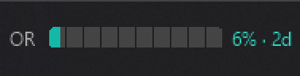

# OpenRouterBar

A small Windows taskbar widget that shows how much of your OpenRouter API key's credit limit you have used.



- **Percent of your own cap.** It reads the key's `limit` and `limit_remaining` from OpenRouter on every check. If you change the key's limit on openrouter.ai, the bar follows at the next check. You don't need to edit any config.
- **Reset countdown.** `2d` is the time until the key's limit resets (daily, weekly or monthly, at 00:00 UTC).
- **Light on the API.** One request every 10 minutes by default. After a failed check it waits longer, up to 1 hour.
- **Sits in the taskbar.** It is drawn inside the taskbar next to the notification area. If the [Claude Code Usage Monitor](https://github.com/CodeZeno/Claude-Code-Usage-Monitor) is running, it docks just to its left, in a matching style.
- **Nothing to install but itself.** It is built from source with the C# compiler that ships with Windows. There is no runtime to install, no admin rights, and no downloaded binary to trust.

Left-click refreshes (at most every 30 seconds). Right-click shows dollars used and left, the reset date and time, today's spend, and links to your OpenRouter keys and activity pages.

## Requirements

- Windows 10 version 1903 or later, or Windows 11 (x64). It uses .NET Framework 4.8, which is part of Windows.
- An OpenRouter API key **with a credit limit set** (openrouter.ai → Settings → Keys → the key → Credit limit). Without a limit, the widget shows `no cap`.

## Install

```powershell
git clone https://github.com/rangogamedev/openrouter-bar.git
cd openrouter-bar
powershell -NoProfile -ExecutionPolicy Bypass -File setup.ps1
```

`setup.ps1` builds `bin\OpenRouterBar.exe` and copies it to `%LOCALAPPDATA%\Programs\OpenRouterBar`. It starts the widget and sets it to start when you sign in, through your user's Run key.

Then store your key:

```powershell
powershell -NoProfile -ExecutionPolicy Bypass -File "$env:LOCALAPPDATA\Programs\OpenRouterBar\set-key.ps1"
```

The key is typed into a hidden prompt, or read from standard input: `... -File set-key.ps1 < keyfile`. It is saved to `key.dat` in the install folder, encrypted with Windows DPAPI for your Windows account. Run both scripts from your own PowerShell window. Admin rights are never needed, and the widget always runs with normal rights. [SECURITY.md](SECURITY.md) explains what DPAPI does and doesn't protect against.

To update, pull and run `setup.ps1` again. To remove everything, including `key.dat`, run `setup.ps1 -Uninstall`.

## Settings

Copy [`settings.example.ini`](settings.example.ini) to `settings.ini` in the install folder, then restart the widget. You can change the check interval, the label, the colors, and the gap next to the Claude monitor.

If the widget shows `--`, open `status.txt` in the install folder. It records the last check's result and error. It never contains the key.

## How it works

| Piece | What it does |
|---|---|
| `src/Core.cs` | Calls `GET https://openrouter.ai/api/v1/key` and parses the response. Also holds the reset-window math and the settings. No UI, covered by `tests/SelfTest.cs`. |
| `src/Widget.cs` | A per-pixel-alpha layered child window of the taskbar (`Shell_TrayWnd`), placed left of the Claude Code Usage Monitor or the notification area. |
| `src/app.manifest` | Declares Windows 8+ compatibility, which layered child windows require, plus per-monitor DPI awareness. |

Percent used is `(limit - limit_remaining) / limit`. The widget does not use the key's lifetime `usage` field, so the number stays right after a reset.

## Build and test

```cmd
build.cmd   :: bin\OpenRouterBar.exe
test.cmd    :: builds and runs bin\SelfTest.exe
```

CI runs both on pushes to `main` and on pull requests.

## Security

See [SECURITY.md](SECURITY.md) for the security model and how to report a vulnerability.

## Acknowledgements

- The look (a 10-segment bar with a `NN% · countdown` label) follows the [Claude Code Usage Monitor](https://github.com/CodeZeno/Claude-Code-Usage-Monitor) by CodeZeno (MIT), so the two widgets sit well side by side. The sizes and palette were matched by measuring its rendered output. None of its code is used.
- Placing a window inside the taskbar, anchored to the notification area, is the approach [TrafficMonitor](https://github.com/zhongyang219/TrafficMonitor) by zhongyang219 uses. None of its code is used.
- Drawing with per-pixel alpha (`GetHbitmap` → `UpdateLayeredWindow` with `AC_SRC_ALPHA`) is the standard Windows technique, popularised for .NET by Rui Lopes' CodeProject article ["Per Pixel Alpha Blend in C#"](https://www.codeproject.com/Articles/1822/Per-Pixel-Alpha-Blend-in-Csharp), and documented by Microsoft under [`UpdateLayeredWindow`](https://learn.microsoft.com/windows/win32/api/winuser/nf-winuser-updatelayeredwindow).
- The API fields and reset rules come from the [OpenRouter API documentation](https://openrouter.ai/docs/api_reference/limits).

## Disclaimer

This is an independent project. It is not affiliated with or endorsed by OpenRouter, Anthropic, or Microsoft. "OpenRouter" and "Claude" are trademarks of their owners.

## License

[MIT](LICENSE)
